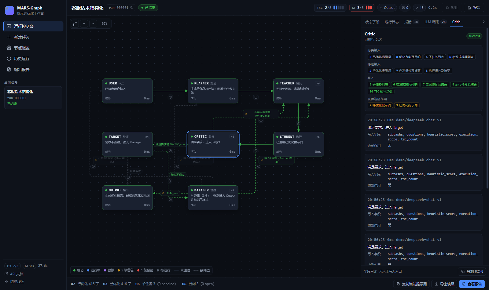
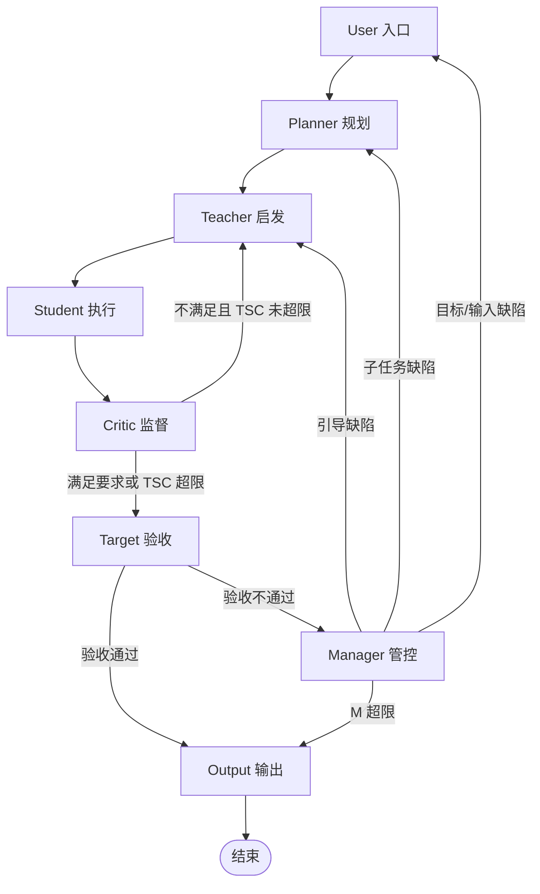

# MARS-Graph

> 多智能体协作的**提示词优化工作台**：把一句“帮我把提示词改好”拆成一条可观察、可干预、可验收的 LangGraph 流水线。

MARS-Graph 基于 LangGraph，用 `State / Node / Edge` 三个概念组织 8 个业务节点与 12 条边，
完成 `User → Planner → Teacher → Student → Critic → Target` 的优化闭环；
Target 验收不通过时由 Manager 判定缺陷归属并回退到 User / Planner / Teacher。
整个过程支持边级断点、人工改道、TSC / M 双循环控制、运行产物落盘与前端实时状态图。

<p align="center">
  
  <br>
  <sub>运行控制台：实时节点状态图、状态抽屉、断点与循环计数（截图为开发期记录，v0.3 已移除演示模型）</sub>
</p>

## 目录

- [它解决什么问题](#它解决什么问题)
- [核心能力](#核心能力)
- [工作流](#工作流)
- [State 一览](#state-一览)
- [快速开始](#快速开始)
- [配置](#配置)
- [接入真实模型](#接入真实模型)
- [状态校验与报错](#状态校验与报错)
- [数据与隐私](#数据与隐私)
- [API](#api)
- [项目结构](#项目结构)
- [质量门槛](#质量门槛)
- [已知边界与路线图](#已知边界与路线图)
- [文档索引](#文档索引)

## 它解决什么问题

提示词优化通常是“改一版、看一眼、再改一版”，过程不可追溯，也无法判断某一版为什么更好。
MARS-Graph 把这件事拆成可检查的步骤：

1. **Planner** 把初始提示词规范化，并拆出可验收的子任务；
2. **Teacher** 用苏格拉底式提问指出下一步该改什么；
3. **Student** 是唯一改写者，产出一版完整的新提示词；
4. **Critic** 逐项打分，决定继续 TSC 循环还是进入验收；
5. **Target** 按用户设定的性能指标做最终验收；
6. 不通过时 **Manager** 判定问题出在目标、拆解还是引导，并回退到对应节点。

用户可以随时在边级断点处暂停，查看完整状态，选择继续原路由、人工改道或中止；
每一轮的子任务、提问、得分、提示词与报告都会落盘，便于复盘。

## 核心能力

| 能力 | 说明 |
| --- | --- |
| 8 个业务节点 | User、Planner、Teacher、Student、Critic、Target、Output、Manager |
| 12 条边 | 4 条普通边 + 8 条条件边，逐条对应核心文档的边表 |
| 双循环控制 | TSC 循环上限 `TSC_MAX=5`、M 回退上限 `M_MAX=3`，均可由创建任务时覆盖 |
| 分级状态校验 | 必填缺失为 1 级终止；待选缺失/格式问题为 2 级警告，且按节点前提触发 |
| 边级断点 | 命中后冻结在“源节点更新完成、目标节点执行前”，可继续 / 改道 / 中止 |
| 人工改道 | 只改变下一节点，不跳过目标节点的必填校验，不改变 TSC / M 计数 |
| 运行产物落盘 | 每次运行写入 `data/runs/<run_id>/`，重启后仍可查看报告、日志与状态快照 |
| 模型配置 | 6 个 LLM 节点可独立配置模型、Base URL、温度、超时、重试与提示词版本 |
| 提示词管理 | 模板按 `vN.md` 版本化，前端可编辑、新建、删除；推荐模板与代码 JSON 契约一致 |
| 密钥保护 | 只写不读回；接口与日志仅返回尾号；支持环境变量与本地文件两种来源 |

## 工作流



两条循环的计数规则：

- **TSC 循环**：Critic 判定不通过且 `tsc_count < TSC_MAX` 时，把 `optimized_prompt` 快照到
  `working_prompt`、置空 `optimized_prompt`、`tsc_count + 1`，回到 Teacher。
- **M 循环**：Target 不通过进入 Manager，Manager 每次实际回退时 `m_count + 1`；
  达到 `M_MAX` 后不再回退，强制进入 Output 并生成失败报告。

## State 一览

完整语义见 [`MARS-Prompt.md`](MARS-Prompt.md)；实现映射见 [`docs/architecture.md`](docs/architecture.md)。

| # | 代码名 | 含义 | 业务写入者 |
| --- | --- | --- | --- |
| 1 | `initial_prompt` | 初始提示词 | User |
| 2 | `working_prompt` | 待优化提示词（当前工作稿） | Planner、Critic（TSC 快照） |
| 3 | `optimized_prompt` | 已优化提示词（本轮产物） | Student、Critic（置空） |
| 4 | `optimization_goal` | 优化方向及目的 | User |
| 5 | `subtasks` | 子任务列表 | Planner、Critic |
| 6 | `questions` | 启发式提问列表 | Teacher、Critic |
| 7 | `heuristic_score` | 启发得分及摘要 | Critic |
| 8 | `execution_score` | 执行得分及摘要 | Critic |
| 9 | `performance_criteria` | 性能指标（初始化后只读） | 入口配置 |
| 10 | `tsc_count` | TSC 循环次数 | Critic |
| 11 | `m_count` | M 循环次数 | Manager |

非业务通道：`route_*`（条件边判定依据）、`trace`（节点执行追踪）、`report_md`（Output 报告）。
状态只保存 JSON 可序列化数据，密钥、客户端与文件句柄不会进入 State。

## 快速开始

前置条件：Python 3.11+、[uv](https://docs.astral.sh/uv/)、Node.js 18+（仅前端构建需要）。

```bash
# 1. 安装后端依赖
uv sync

# 2. 运行测试
uv run pytest

# 3. 构建前端（产物由 FastAPI 直接托管）
cd frontend
npm install
npm run build
cd ..

# 4. 启动单进程服务
uv run uvicorn mars.api.app:app --host 127.0.0.1 --port 8000
```

打开 <http://127.0.0.1:8000>。

> **必须单 worker 运行。** 图检查点、运行事件与节点配置覆盖都保存在进程内存；
> 使用 `--workers N`（N > 1）会导致请求落到不同进程而出现随机的 404 / 状态丢失。
> 需要水平扩展时，先完成“检查点与事件流外置”的改造（见路线图）。

前端开发模式（热更新，接口经 Vite 代理到 8000）：

```bash
uv run uvicorn mars.api.app:app --reload   # 终端 1
cd frontend && npm run dev                  # 终端 2 → http://127.0.0.1:5173
```

## 配置

所有后端配置来自 `MARS_` 前缀环境变量：

| 变量 | 默认值 | 说明 |
| --- | --- | --- |
| `MARS_LLM_API_KEY` | 空 | 默认 LLM 密钥；也可在前端「节点配置 → 设置密钥」写入本地文件 |
| `MARS_API_KEY_ENV` | `MARS_LLM_API_KEY` | 节点默认引用的密钥环境变量名 |
| `MARS_DEFAULT_MODEL` | `deepseek-chat` | 默认模型名 |
| `MARS_BASE_URL` | `https://api.deepseek.com/v1` | OpenAI 兼容接口地址 |
| `MARS_TEMPERATURE` | `0.2` | 默认采样温度 |
| `MARS_TIMEOUT_S` | `60` | 单次 LLM 调用超时（秒） |
| `MARS_MAX_RETRIES` | `2` | 结构化输出失败后的重试次数 |
| `MARS_PROMPT_VERSION` | `v1` | 默认提示词版本 |
| `MARS_NODE_CONFIGS` | 空 | 节点级配置覆盖，JSON 字符串 |
| `MARS_DATA_DIR` | `data/runs` | 运行产物目录 |
| `MARS_HOME` | 未设置 | 设置后密钥文件为 `<MARS_HOME>/secrets.json`；未设置时为 `./.mars/secrets.json` |

示例：

```bash
export MARS_LLM_API_KEY="your-api-key"
export MARS_BASE_URL=https://api.deepseek.com/v1
export MARS_DEFAULT_MODEL=deepseek-chat
```

## 接入真实模型

1. 打开 **节点配置**，选择节点，填写模型名与 Base URL；
2. 点 **设置密钥** 粘贴 API Key —— 只写入本机 `.mars/secrets.json`（权限尽力设为 600，已加入 `.gitignore`）；
   接口与日志只返回尾号，不提供“显示明文”；
3. 在 **系统提示词模板** 中确认 `v1` 内容（仓库已内置完整的角色、职责、边界、输出规范与约束）；
   也可以点 **载入推荐模板** 对照 `mars/llm/defaults.py`；
4. 点 **测试连接** 验证模型与密钥可用，再回到 **新建任务** 启动。

密钥优先级：**进程环境变量 > `.mars/secrets.json`**。清除密钥只影响本进程与本地文件，
不会修改 shell 配置。

6 个 LLM 节点共用同一个默认密钥名；如果不同节点需要不同供应商，可在节点配置里分别改
`api_key_env` 并录入对应密钥。

## 状态校验与报错

校验遵循核心文档的两级语义：

| 级别 | 触发 | 行为 |
| --- | --- | --- |
| 1 级 | 必填字段缺失或为 `null` | 终止运行，不写入状态，前端红色告警 |
| 2 级 | 待选字段在**当前上下文**确实缺失、格式不规范、LLM 输出不合约 | 继续运行，写入 `trace.issues`，黄色告警 |

“待选字段缺失”不是无条件报错——每个节点只在文档规定的前提成立时校验：

| 节点 | 字段 | 触发前提 |
| --- | --- | --- |
| User | 1 / 4（缺失或空白） | 由 Manager 回退唤醒（`m_count > 0`） |
| Planner | 3 / 5 | TSC 进行中（`tsc_count > 0`） |
| Teacher | 3 / 6 / 7 / 8 | TSC 进行中 |
| Teacher | 1 / 4 | 由 Manager 唤醒 |
| Student | 5 | 无（Teacher 已保证存在） |
| Critic | 2 / 7 / 8 | TSC 第二轮起 |

另外，`working_prompt` 与 `optimized_prompt` 在循环/回退阶段的“置空”是文档定义的正常状态，
不判格式错误。**正常路径、TSC 超限路径与 Manager 回退路径的 trace 均应为零 issues**，
这一点由 `mars/tests/graph/test_graph.py` 直接断言。

## 数据与隐私

每次运行在 `data/runs/<run_id>/` 下生成：

```
meta.json            # 名称、状态、验收结论、循环上限与计数（不含完整提示词）
run.log              # 逐行 JSON 事件日志（写入前剔除提示词与报告正文）
state.json           # 最近一次状态快照（含业务内容，请按数据处理）
report.md            # Output 生成的总结报告
output_prompt.txt    # 最终提示词
error.json           # 仅失败运行生成
```

- `data/runs/*` 与 `.mars/` 均已加入 `.gitignore`；删除运行数据只允许在运行结束后执行。
- 密钥文件默认位于 `./.mars/secrets.json`；设置 `MARS_HOME` 后位于 `<MARS_HOME>/secrets.json`。
  接口只返回 `configured / tail / source`。
- `run.log` 不记录完整提示词与报告；`state.json` / `report.md` 属于用户数据，部署时需按敏感数据管理。
- 本项目**没有登录、多租户与权限体系**。不要把实例直接暴露到公网；若需共享，请放在受控内网或反向代理鉴权之后。

## API

| 方法 | 路径 | 用途 |
| --- | --- | --- |
| `GET` | `/health` | 健康检查 |
| `GET` | `/meta` | 数据目录、密钥路径、模板目录与默认循环上限 |
| `GET` | `/graph/edges` | 边表，用于配置断点 |
| `POST` | `/runs` | 创建运行（`name`、`tsc_max`、`m_max`、`breakpoints`） |
| `GET` | `/runs` | 运行摘要列表（内存 + 持久化合并） |
| `GET` | `/runs/{id}` | 状态快照；内存缺失时回退磁盘快照 |
| `GET` | `/runs/{id}/events` | SSE 事件流（节点开始/结束、断点、完成/失败） |
| `GET` | `/runs/{id}/report` | 读取磁盘报告与最终提示词 |
| `GET` | `/runs/{id}/log` | 读取运行日志末尾 |
| `DELETE` | `/runs/{id}/data` | 删除该优化的整个数据子文件夹 |
| `POST` | `/runs/{id}/breakpoints` | 替换断点边集合 |
| `POST` | `/runs/{id}/resume` | 继续 / 改道 / 中止，可附用户补充 |
| `GET` | `/config/nodes` | 查看 6 个 LLM 节点配置与可用模板版本 |
| `PATCH` | `/config/nodes/{node}` | 修改模型、温度、超时、提示词版本 |
| `DELETE` | `/config/nodes/{node}` | 恢复节点默认配置 |
| `POST` | `/config/nodes/{node}/test` | 用最短提示词测试模型与密钥连通性 |
| `GET` | `/config/nodes/{node}/prompt?version=v1` | 读取模板正文与推荐模板 |
| `PUT` | `/config/nodes/{node}/prompt` | 写入或覆盖某个模板版本 |
| `DELETE` | `/config/nodes/{node}/prompt?version=v2` | 删除模板版本（至少保留一个、不可删在用版本） |
| `GET` | `/config/secrets` | 密钥状态（是否配置 + 尾号 + 引用节点） |
| `PUT` | `/config/secrets/{env_name}` | 写入密钥，立即生效并落盘 |
| `DELETE` | `/config/secrets/{env_name}` | 清除密钥 |

恢复载荷：

```json
{"action": "continue"}
{"action": "reroute", "target": "planner", "operator": "operator-1"}
{"action": "abort"}
```

在 Manager→User 断点恢复时，可附带 `initial_prompt` / `optimization_goal` 与
`supplement_mode`（`append` 或 `replace`），作为 User 节点的追加输入。

## 项目结构

```
mars/
  api/            FastAPI 入口、DTO、SSE 与静态托管
  graph/
    builder.py    仅装配 StateGraph
    edge_table.py 12 条边的唯一数据源
    nodes/        8 个业务节点
    routing/      3 个纯路由函数
    state/        State、模型、常量、分级校验、错误码
  llm/            适配器、结构化输出、推荐模板
  prompts/        各节点系统提示词（vN.md）
  runtime/        运行管理、断点、检查点、落盘、报告
  config/         环境配置与本地密钥存储
  tests/          单元、路由、不变量、图集成、API 测试
frontend/         React 18 + TypeScript + Vite 工作台
docs/             架构、运维、设计记录与截图
```

## 质量门槛

```bash
uv run ruff check mars
uv run ruff format --check mars
uv run mypy mars
uv run pytest --cov=mars
```

当前状态（本仓库实测）：

- `pytest`：**159 passed**
- 覆盖率：业务代码约 **94%**；含测试辅助代码的整体统计为 **96%**
- `ruff check` / `ruff format --check` / `mypy --strict`：全部通过
- 前端 `npm run build`：通过（`tsc -b && vite build`）
- 正常路径 / TSC 超限 / Manager 回退：trace 中 **0 条报错**

## 已知边界与路线图

当前版本定位为**单实例、内网可用的工程化原型**，不是多租户 SaaS。已知边界：

- 没有登录、权限、租户隔离与计费；节点配置是进程级全局配置。
- 图检查点在进程内存，服务重启后不能续跑；已完成运行的报告/日志已落盘可查。
- 没有并发上限、运行级超时/费用预算、取消接口与事件保留策略。
- 没有数据库、备份、指标与分布式追踪；SSE 依赖单进程内存事件队列。
- 没有前端单元测试与浏览器 E2E；截图是开发期记录。
- API 未做 `/v1` 版本化；修改默认端口/路径属于破坏性变更。

按生产上线的优先级，下一步建议：

1. **持久化**：SQLite/Postgres 存检查点、运行与事件，替换 `InMemorySaver`；
2. **安全**：登录/令牌、按用户隔离配置、限制 `base_url` 与 `api_key_env` 白名单；
3. **运行治理**：并发队列、单次运行超时与 token 预算、取消与事件 TTL；
4. **可观测性**：结构化指标、trace、告警与审计日志；
5. **部署**：Dockerfile、CI、优雅停机、反代与 HTTPS，明确单实例或外置状态；
6. **测试**：真实模型录制回放、前端 E2E、故障注入与压测。

## 文档索引

| 文档 | 内容 |
| --- | --- |
| [`MARS-Prompt.md`](MARS-Prompt.md) | 产品与图语义的唯一权威（State / Node / Edge / 循环 / 断点） |
| [`CODE_STANDARDS.md`](CODE_STANDARDS.md) | 代码、状态、节点、边、测试与提交规范 |
| [`docs/README.md`](docs/README.md) | 文档导航与阅读顺序 |
| [`docs/architecture.md`](docs/architecture.md) | 实现视角的架构、字段映射、节点契约与校验前提 |
| [`docs/operations.md`](docs/operations.md) | 启动、配置、密钥、数据保留、隐私清理与排障 |
| [`docs/design/frontend-design-v0.1.md`](docs/design/frontend-design-v0.1.md) | 前端产品设计与实现变更记录 |

---

如果这份 README 与核心文档冲突，**以 `MARS-Prompt.md` 为准**；实现细节以代码与测试为准。
